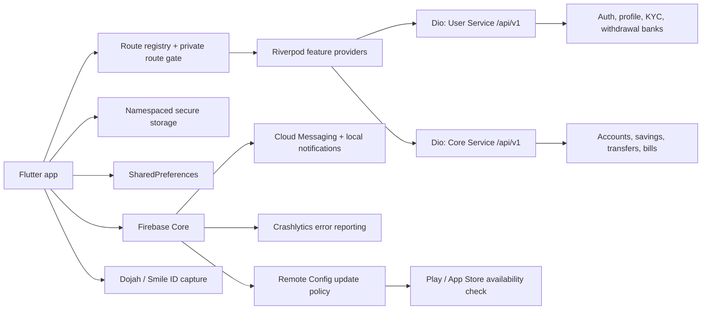
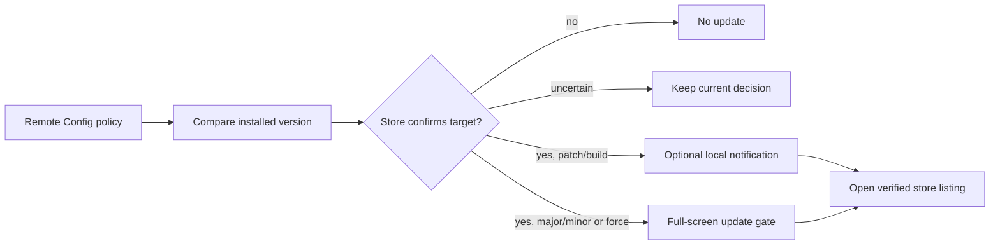
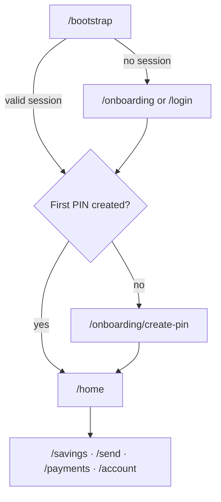

# Cheetah Savings & Payments App

Cheetah is a Flutter mobile app for BOCTRUST savings, payments, transfers, and
account management. The app uses Riverpod for state, Dio for API transport, and
separate User and Core services. The route registry and capability map decide
which screens and actions a build can offer.

> [!NOTE]
> A registered route is not necessarily an available operation. Some flows
> require a Core URL, staging mode, a backend contract, or provider credentials.
> See [Routes and availability](#routes-and-availability).

## At a glance

| Area | Source of truth |
| --- | --- |
| Startup and app root | [`lib/main.dart`](lib/main.dart), [`lib/app.dart`](lib/app.dart) |
| Named routes and access | [`lib/app/app_router.dart`](lib/app/app_router.dart), [`lib/module/app_flow/route_definitions.dart`](lib/module/app_flow/route_definitions.dart) |
| Feature gates | [`lib/app/feature_capability.dart`](lib/app/feature_capability.dart) |
| User and Core endpoints | [`lib/app/api_endpoints.dart`](lib/app/api_endpoints.dart), [`lib/app/core_api_endpoints.dart`](lib/app/core_api_endpoints.dart) |
| Configuration | [`lib/app/services.dart`](lib/app/services.dart), [`.env.example`](.env.example) |
| Firebase setup | [`firebase.json`](firebase.json), [`lib/firebase_options.dart`](lib/firebase_options.dart) |
| Store update policy | [`lib/app/update/`](lib/app/update), [release runbook](docs/app-update-release-runbook.md) |
| Shorebird | Planned; no project integration is tracked yet. See [Shorebird status](#shorebird-status). |

## Setup

1. Install Flutter **3.44.6** (Dart **3.12.2**). For iOS, install Xcode and an
   iOS simulator; iOS deployment starts at **15.0**.
2. Fetch packages. If `.env.stage` does not exist yet, copy the example
   configuration:

   ```sh
   flutter pub get
   cp .env.example .env.stage
   ```

3. Set `ENV=staging`, a valid User Service `BASE_URL`, `SITE_URL`, and a unique
   `SECURE_STORAGE_NAMESPACE`. Set `CORE_BASE_URL` to enable Core-backed flows.
   Supply the Dojah widget IDs for KYC and transfer liveness used in this
   environment. Environment files are gitignored; do not commit real values.
4. For Smile ID capture, have the environment's secret-delivery process place
   `assets/json/smile_config.json` before building. See
   [`assets/json/README.md`](assets/json/README.md).
5. Start a device or simulator, then run:

   ```sh
   flutter run --dart-define-from-file=.env.stage
   ```

The app requires a reachable backend for signed-in flows. An empty
`CORE_BASE_URL` is allowed, but Core capabilities are unavailable. Firebase
initialization failure does not prevent login or app startup.

### Build-time configuration

| Key | Purpose |
| --- | --- |
| `ENV` | `staging` or `prod`; validated at bootstrap. |
| `BASE_URL` | HTTPS User Service root ending in `/api`; the app appends `/v1`. |
| `CORE_BASE_URL` | Optional HTTPS Core Service root ending in `/api`; the app appends `/v1`. |
| `SITE_URL` | HTTPS public site root for legal pages. |
| `SECURE_STORAGE_NAMESPACE` | Separates stored sessions between environments. |
| `DOJAH_SELFIE_WIDGET_ID` | BVN selfie/liveness widget. |
| `DOJAH_GOVERNMENT_WIDGET_ID` | Government ID widget. |
| `DOJAH_TRANSFER_WIDGET_ID` | Large-transfer liveness widget. |
| `DOJAH_USE_SANDBOX_BVN` | `true` substitutes Dojah's sandbox BVN in staging only. |
| `CRASHLYTICS_ENABLED` | Enables collection only in a supported, non-debug build with Firebase ready; see the [runbook](docs/crashlytics-runbook.md). |

Configuration is read with Dart compile-time defines in
[`lib/app/services.dart`](lib/app/services.dart); changing a file requires a new
run or build. Use a separate namespace for each environment to avoid session
reuse across backends.

## Infrastructure



Both API clients use the signed-in User Service bearer token. A User Service
session expiry clears the local session; a Core `401` is reported as a Core
error and does not sign the customer out. Network clients use 30-second default
timeouts, response mapping, request logging, and error classification.
`lib/module/` contains feature-specific models, services, providers, and
screens; `lib/module/component/` contains reusable UI; `lib/helper/` contains
device integrations and secure storage; `lib/utils/` contains formatting and
validation helpers.

The repository includes Android, iOS, web, Windows, macOS, and Linux Flutter
targets. Native KYC capture needs a physical device. iOS dependencies use
Swift Package Manager; the local Dojah plugin is Android-only and iOS opens
Dojah's hosted flow in a WebView.

## Firebase and notifications

FlutterFire configuration is checked in for the `boctrust` Firebase project.
The app initializes Firebase using the generated
[`lib/firebase_options.dart`](lib/firebase_options.dart). The platform file
locations are recorded in [`firebase.json`](firebase.json):

| Platform | Native configuration in this repository |
| --- | --- |
| Android | [`android/app/google-services.json`](android/app/google-services.json); Google Services and Crashlytics Gradle plugins are applied in [`android/app/build.gradle.kts`](android/app/build.gradle.kts). |
| iOS | [`ios/Runner/GoogleService-Info.plist`](ios/Runner/GoogleService-Info.plist); the Runner project includes it and uploads Crashlytics symbols. |
| macOS | [`macos/Runner/GoogleService-Info.plist`](macos/Runner/GoogleService-Info.plist). |
| Web and Windows | Entries in `lib/firebase_options.dart`; no native application file in this repository. |

Linux has no generated Firebase options. Firebase initialization failures are
caught during startup, so the app still opens, while Firebase-dependent
features remain inactive.

- **Cloud Messaging:** after a signed-in session is ready, the app requests
  notification permission, obtains an FCM token, and registers or refreshes it
  through the User Service. Foreground messages are displayed as local
  notifications; displayable data-only background messages use the background
  handler. Notification taps route through the app's validated navigation flow.
- **Crashlytics:** `CRASHLYTICS_ENABLED=true` permits collection on Android and
  iOS outside debug mode when Firebase initialized. Otherwise the app uses a
  no-op reporter. See the [Crashlytics runbook](docs/crashlytics-runbook.md) for
  redaction, rollout, and symbol handling.
- **Remote Config:** `app_update_policy_v1` controls store-gated update checks
  described below. A missing or invalid policy leaves updates disabled.

Staging and production use the same checked-in Firebase application
configuration; `ENV` and `CRASHLYTICS_ENABLED` are build-time controls, not
separate Firebase app flavors.

## App updates

On Android and iOS non-debug builds, the app reads the Firebase Remote Config
parameter `app_update_policy_v1` at launch, after returning from the background,
and when Remote Config activates a change. Its built-in default disables
updates on both platforms. The installed version comes from the app package;
the app then confirms the release with Google Play or the App Store before it
shows an update prompt. Web, desktop, and debug builds skip these checks.



The required gate covers every route and blocks navigation until the user
updates or the policy is relaxed. An optional update posts at most one local
notification per target release; it depends on notification permission. A
failed or uncertain store check does not create a new gate. The app displays
its installed version on key entry and account screens.

The release process is: publish the binary, confirm availability on the
intended store track or territories, then publish the Remote Config policy.
Use the [app update release runbook](docs/app-update-release-runbook.md) for
the JSON schema, version rules, store checks, and rollback procedure.

### Shorebird status

Shorebird integration is planned. This repository does not currently contain
a `shorebird.yaml`, Shorebird updater integration, or a Shorebird release or
patch workflow. The update feature above checks **full app releases** in Google
Play and the App Store; it does not download Shorebird patches. Document
Shorebird setup and patch delivery here after the release configuration and
patch process are added to the repository.

## Routes and availability

Routes below are **client navigation paths**, not HTTP API endpoints. The
complete registry is [`appRouteDefinitions`](lib/module/app_flow/route_definitions.dart);
`AppRoutes.allRoutes`, public routes, and private routes are derived from it.
Most routes require a restored session and first PIN. Public routes cover entry,
authentication, first-PIN setup, legal content, and support placeholders.



| Route group | Representative paths | What it opens |
| --- | --- | --- |
| Entry and auth | `/bootstrap`, `/onboarding`, `/onboarding/otp`, `/login`, `/login/password-reset` | Session restore, signup, sign-in, recovery. |
| Main tabs | `/home`, `/savings`, `/send`, `/payments`, `/account` | Bottom navigation sections. |
| Savings and funding | `/savings/flex`, `/savings/target`, `/savings/lock`, `/savings/group`, `/wallet/add-money` | Balances, products, plan flows, funding details. Some actions remain gated. |
| Transfers and activity | `/send/own-account`, `/send/beneficiary`, `/send/other-bank`, `/send/scan-to-pay`, `/transactions`, `/transaction/receipt` | Core-backed transfer, activity, and receipt flows when capabilities are enabled. |
| Payments | `/payments/airtime`, `/payments/data`, `/payments/billers/electricity`, `/payments/bill-pay` | Core-backed bill and top-up flows, gated by staging and configuration. |
| Account and KYC | `/account/tier`, `/account/tier/government-id`, `/account/linked-banks`, `/account/security`, `/account/limits` | Identity, linked banks, security, and limits. |
| Other | `/notifications`, `/account/legal/privacy`, `/account/loans`, `/account/cards` | Notification placeholder, legal pages, and coming-soon products. |

[`featureAvailabilityProvider`](lib/app/feature_capability.dart) evaluates
the capability requirements. Core transfers, payments, beneficiaries, account
activity, and several savings actions are currently **staging-only** and also
need `CORE_BASE_URL`. Card funding, hosted checkout, and some savings actions
have explicit unavailable screens. Loans and Cards are coming soon. Consult
the capability map before treating any registered route as a live operation.

## Platform and identity setup

### iOS build setup

iOS native dependencies use Swift Package Manager only, through Flutter's
generated `FlutterGeneratedPluginSwiftPackage`; the project has no Podfile. The
repository-local Dojah plugin is registered for Android only, so iOS does not
link DojahWidget or Realm. On iOS, Dojah opens the hosted identity flow
(`https://identity.dojah.io/?widget_id=…&metadata[reference]=…&loading=async`)
in an embedded WebView. Use
Flutter 3.44.6 (Dart 3.12.2) with Xcode; the local migration toolchain is Xcode
26.6. The app supports iOS 15.0 and later.

```sh
flutter pub get
flutter build ios --simulator --debug
flutter run --dart-define-from-file=.env.stage
```

For Xcode development, open `ios/Runner.xcworkspace` and select the Runner
scheme. Run Flutter with the environment configuration first so Xcode inherits
the generated build settings. Keep the scheme's **Run Prepare Flutter
Framework Script** pre-action and Flutter build phases enabled.

The tracked SwiftPM `Package.resolved` files control native dependency
versions. Do not reintroduce CocoaPods or register the Dojah plugin for iOS;
CI fails if either returns. Do not add duplicate Firebase or Smile ID packages
directly to Runner. Do not
commit `ios/Flutter/ephemeral`, `Generated.xcconfig`, or generated registrants.
CI checks a simulator Debug build and an unsigned device Release build;
physical-device plugin checks and distribution signing remain separate release
checks.

### KYC provider configuration

Dojah is launched only when the backend initiation response selects `dojah`.
The app supplies the backend-issued reference and the operation-specific widget
ID; it does not send the BVN or document number to the SDK. Provider completion
is reconciled against the backend status because the SDK return value is not a
verification verdict. Smile ID remains supported when the backend selects it or
returns the existing legacy Smile job context.

### Smile ID configuration

KYC capture needs `assets/json/smile_config.json`, the partner configuration
downloaded from the Smile ID portal. It is gitignored and must be injected into
the build workspace by each environment's secret-delivery process before
`flutter run` or `flutter build`; see `assets/json/README.md`. Without it the
app still builds, and the document-capture screen shows a retry state rather
than crashing.

Do not set `SMILE_ID_API_KEY`. It was removed: that key is the backend's
signature secret, and the mobile SDK takes its `auth_token` from the asset
config instead. Never pass it to `SmileID.initializeWithApiKey`.

### Logging

API traffic is printed through the `logger` package with structured request,
response, error, and duration details. Staging logs and every debug build's
logs (production config included, see `Env.logsSensitiveData`) are
intentionally unredacted so testers and developers can read request and
response payloads, and must only be captured on controlled development devices.
Production profile builds recursively redact the `_sensitiveKeyParts` set.

A narrower set is redacted in **every** environment, staging included, and does
not depend on that flag: `auth_token`, `partner_id`, the Smile config, the Smile
`callbackUrl` and its query, `accountNumber`, `identityNumber`,
`documentNumber`, and raw SDK result JSON. See `_alwaysRedactedKeyParts` in
`lib/app/interceptors.dart`. Do not move a value out of that set to make
debugging easier.

**Production release builds** (`ENV=prod` and `kReleaseMode`, see
`Env.releaseLogPolicy`) log metadata only: event, method, URL, status, duration,
error type and the opaque request ID (RESPONSE and ERROR). Query, headers, request and response bodies, server messages,
exception text and stack traces are dropped, not masked. Production debug
builds log in full, like staging. Signed uploads follow the same rule, except that
the full signed upload URL is still logged by decision. That URL is a bearer
credential until it expires. It appears only in the app logger, never in
Crashlytics fields. Logs are device-level (logcat on Android, os_log on iOS);
nothing ships them off the device, so access and retention are whatever the
device's log access allows.

### Government-ID documents

The government-ID form is driven by two authenticated User Service reads,
cleared on logout, expiry, and user switching:

- `GET /users/me/kyc/government-id/document-types` is the catalogue. Only
  active rows this build knows are offered, in server order. A failed,
  malformed, or empty catalogue shows Retry; there is no hard-coded fallback.
- `GET /users/me/kyc/provider-config` filters that catalogue by what
  `governmentId.provider` can launch. A `staging` build accepts only a
  `sandbox` environment and a `prod` build only `live`; any mismatch blocks
  initiation.

`national_id` is shown as “NIN, National Identity Number” and stays distinct
from `nin_slip` (“NIN slip”). The document number field appears, and
`documentNumber` is sent, only when the selected row has
`requiresDocumentNumber: true`.

The provider returned by `POST /users/me/kyc/government-id/initiate` remains
authoritative for each attempt. Dojah is the default provider and accepts
every known document, including `national_id` (confirmed on the staging
government-ID widget on 2 October 2026). Smile is limited to `voter_id`:
its published matrix lists only Nigerian `VOTER_ID` for Enhanced Document
Verification, and `national_id` has no Smile mapping. Dojah widget IDs remain
environment inputs because the provider config does not publish them, and the
Dojah webhook is backend-only. Smile ID v12 token retrieval waits for the
backend to publish token expiry (`expiresAt` or `expiresInSeconds`).

## Verify

```sh
flutter analyze
dart format --output=none --set-exit-if-changed lib test
flutter test
```

`flutter analyze` is expected to report no issues.

### Physical-device testing

The Dojah and Smile ID capture flows use native camera views and cannot be
exercised by `flutter test` or a simulator. Before releasing a change to the KYC
journey, verify both providers on one physical Android and one physical iOS
device: initialization failure and retry, camera and microphone permission
denied and re-granted, selfie liveness, a successful Voter ID capture, user
cancellation, a native SDK error, submission acknowledgement, delayed and
failed webhooks, manual refresh, background/resume refresh, and logout cleanup.

## Repository map

```text
lib/
├── app/                 bootstrap, routing, API clients, theme, capability gates
├── helper/              secure storage, Firebase, notifications, device helpers
├── module/              feature slices and shared UI components
├── utils/               validation and formatting
└── main.dart             process startup
test/                     unit and widget tests
packages/dojah_kyc_sdk_flutter/  local Android Dojah plugin
assets/                   fonts, images, SVGs, runtime JSON directory
docs/                     contract notes, verification records, runbooks
.github/workflows/        Flutter quality and iOS build checks
```

## UI conventions

The root theme applies Plus Jakarta Sans, light and dark palettes, and the
Riverpod theme preference. `SharedPreferences` persists device preferences;
secure storage holds namespaced session data. Shared buttons, cards, fields,
spacing, and navigation components live in `lib/module/component/`.

## More detail

- [Core banking integration notes](docs/verification/core-banking-integration.md)
- [iOS Swift Package Manager verification](docs/verification/ios-swift-package-manager.md)
- [Dojah KYC verification](docs/verification/dojah-kyc.md)
- [Crashlytics runbook](docs/crashlytics-runbook.md)
- [App update release runbook](docs/app-update-release-runbook.md)
- [Current endpoint gaps](docs/endpoint-gaps-2026-10-14.md)
